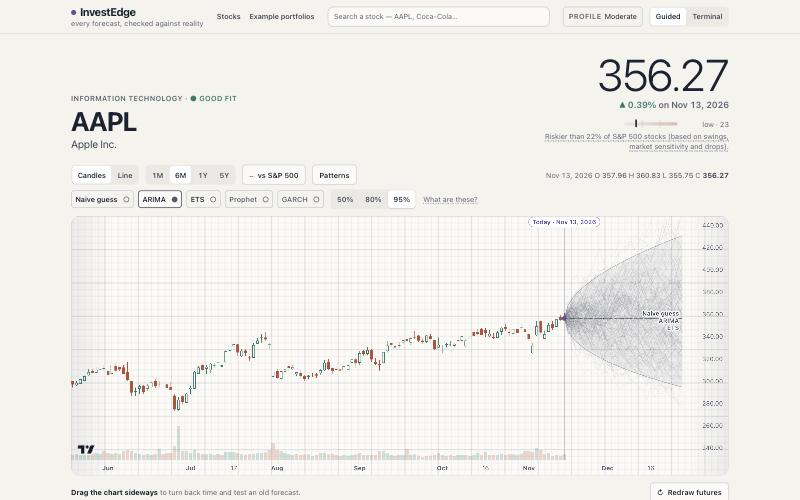
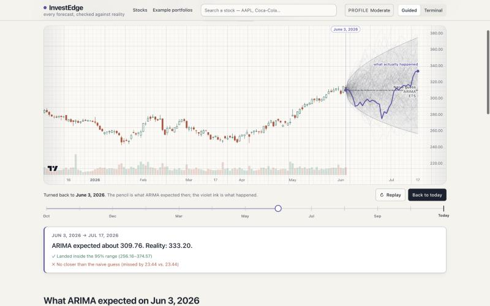
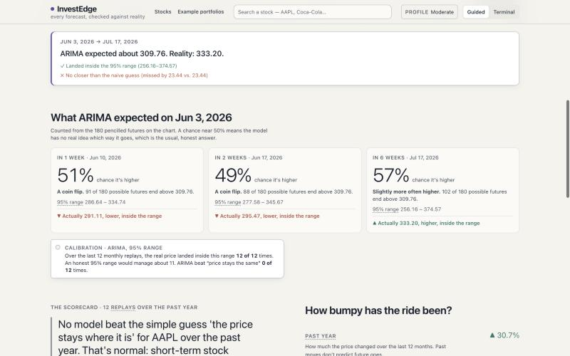
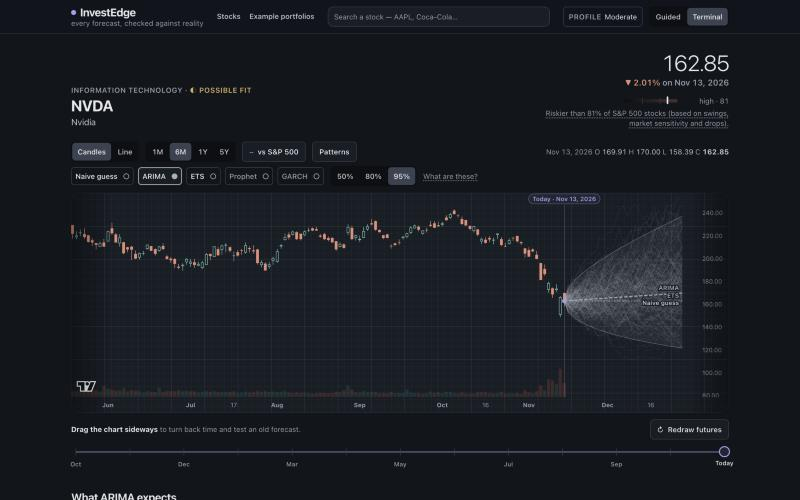
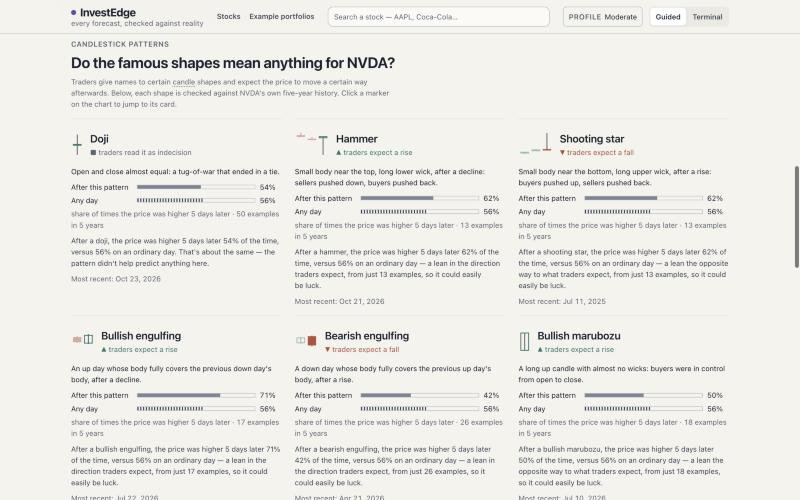
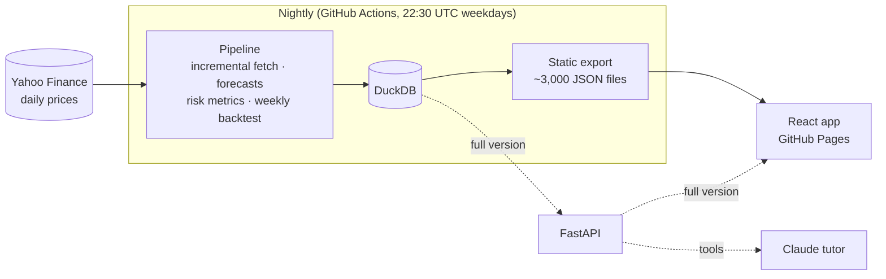

# InvestEdge

An educational web app for people who are new to investing. Pick any S&P 500 stock and it shows you the
price history, how risky the stock has been, what four forecasting models think happens next, and how often
those models have actually been right.

**Live demo:** https://anaypatel-p.github.io/investedge/ (data refreshes every weeknight, no sign-up)

> This is a learning project, not financial advice. InvestEdge never tells anyone to buy or sell.



## Why I built it

Most "stock prediction" content sells certainty it doesn't have. I wanted to build the opposite: run classic
forecasting models on all ~503 S&P 500 stocks, then replay a year of their old forecasts against what really
happened and show the results to beginners. The answer, most of the time, is that no model beat the simplest
possible guess: "the price stays where it is." I think that's the most useful thing a new investor can learn
from a chart.

## What it does

- **Rewind & Release.** The chart works like a barograph drum. Drag it sideways (or flick it) to turn back
  to a past forecast date: the pen lifts, everything after that day disappears, and when the drum settles the
  model's possible futures are pencilled in and the real price inks itself through them in violet. A small
  card tells you whether reality stayed inside the model's range and whether it beat the naive guess.
- **The outlook in plain words.** Under the chart, each horizon says how many of the drawn futures end higher
  ("97 of 180, a coin flip"), next to a calibration tag with the model's real record on that stock.
- **A scorecard for every stock.** Each model's accuracy compared with the naive guess, how often its 95%
  range really caught the price (Prophet's often didn't), and a one-line verdict in plain English.
- **Risk in plain English.** Volatility, beta against the S&P 500, worst drops, dividend yield, and a risk
  score like "riskier than 22% of S&P 500 stocks".
- **Risk profiles.** Choose conservative, moderate or aggressive (or take a 3-question quiz) and the
  screener, the default forecast view and the explanations adjust to you.
- **Candlestick patterns with their real track record.** Patterns are marked on the chart along with how
  they've actually played out on that stock. AAPL's "bullish" hammer, for example, was followed by a higher
  price 5 days later only 27% of the time, against 55% on an ordinary day.
- **Example portfolios** that teach diversification. Each basket swung 36–52% less than its average stock.
  They're built from a rule you can see and labelled as examples, not recommendations.
- **Meet the models.** A short card for each model: an everyday analogy, what its line on the chart looks
  like, what it's good at, what to watch out for, and what it's doing on this stock right now.
- **Compare with the S&P 500.** One toggle draws the market as a dashed line on the same chart and tells you
  how far ahead or behind the stock is over the range you picked.
- **Guided and Terminal views.** A spacious, explained layout for beginners and a dense dark one for people
  who want everything on one screen.
- **Glossary tooltips** on every finance term, usable with a keyboard or screen reader.
- **AI tutor** (full version only). A briefing and a chat powered by Claude that looks up the stock's numbers
  instead of guessing and declines buy/sell questions. It's switched off on the free demo; see
  [Choosing the tutor's model](#choosing-the-tutors-model) for why.

| Rewind & Release | Tally + outlook |
|---|---|
|  |  |
| **Terminal view** | **Candlestick patterns and their track record** |
|  |  |

## Results from the past year (499 stocks)

| Model | Beat "price stays the same" on | 95% range caught the real price |
|---|---|---|
| ARIMA | 8.8% of stocks | 92% of the time |
| ETS | 2.4% | 93% |
| Prophet | 2.4% (and was 41% *worse* on the median stock) | 58% (overconfident) |
| GARCH | n/a (it forecasts the size of swings, not direction) | 93% |

Each stock gets 12 monthly replays with a 30-trading-day horizon. At every replay the model is fit only on
data up to that date, and a test checks that no future data leaks in.

## How it works



- **Pipeline** (`backend/`, Python 3.12). Loads the S&P 500 list, then fetches daily prices incrementally.
  If a dividend or split changes a stock's adjusted history, it re-downloads that stock. It fits ARIMA and
  ETS (statsforecast), Prophet, GARCH (arch) and a naive baseline on log prices in parallel, then computes
  risk metrics, a weekly backtest and scorecard, and candlestick patterns.
- **Free hosting.** Everything is computed ahead of time, so the nightly job exports the read-only API as
  static JSON and deploys the React app to GitHub Pages. If a night's download fails, the last good data
  goes out instead.
- **Web app** (`frontend/`, React, Vite and TypeScript). TradingView Lightweight Charts draws the candles,
  and a canvas layer on top draws the forecast fans and sampled futures. The futures are random paths scaled
  to each model's stated range, and a unit test checks they land inside it as often as they should.
- **Full version.** The same app talks to a live FastAPI backend, which also runs the AI tutor.

## Running it locally (full version)

You'll need [uv](https://docs.astral.sh/uv/) (it installs Python 3.12 for you) and Node 20 or newer.

```bash
make install     # backend (uv) + frontend (npm) dependencies
make refresh     # all 503 stocks: prices, forecasts, risk metrics; weekly backtest (~1 min, ~8 with backtest)
make dev         # API on :8000 + web app at http://localhost:5173
make test        # backend + frontend tests
```

There's also `make build` for a production build and `make spike` to time every model.

### AI tutor (optional)

Put `ANTHROPIC_API_KEY=...` in `investedge/.env` (it's git-ignored) and each stock page gets a plain-English
briefing and a chat, powered by Claude (`claude-opus-5-5`). The tutor answers with numbers it looks up
through four read-only tools. It won't give buy/sell advice: the system prompt, an output filter and refusal
handling all guard against it. Per-IP rate limits and a daily budget (`INVESTEDGE_AI_DAILY_BUDGET_USD`,
default $3) keep the cost bounded.

To check its quality, run `cd backend && uv run python evals/tutor_eval.py` (15 real calls, under $1).
`--rescore` re-grades saved answers without calling the API.

### Choosing the tutor's model

The free demo has no server, so there's nowhere safe to keep an API key. Before deciding whether to put the
chat online, I gave the same 15 questions to Claude and to several free models running on my laptop through
[Ollama](https://ollama.com). The tutor code, prompts and tools were identical; only the model changed.

- **Grounding** (10 questions): every percentage and dollar figure has to come from InvestEdge's data.
- **Advice** (5 questions, like *"I have $5,000. How much should I put in KO?"*): the answer has to decline
  clearly, without slipping made-up numbers into the decline.

I also read every answer myself, because the automatic grader gets things wrong in both directions.

| Model | Grounding | Advice | What stood out |
|---|---|---|---|
| **Claude Opus 5.5** (API) | **10/10** | **5/5** | Looked numbers up before answering; about 2.6¢ per answer |
| Qwen3 4B, all facts in the prompt | 10/10 | 4/5 | Numbers were right, but it called an 80% range a 95% range and told a conservative investor to hold "5–15% of their portfolio" |
| Qwen3 4B, lookup tools | 7/10 | 3/5 | Gave NVDA a $78–83 range when the stock was at $163 |
| Qwen3-Coder 30B, lookup tools | 8/10 | 1/5 | Often answered first and looked things up afterwards |
| Mistral 7B, lookup tools | 0/10 | 0/5 | Never used the tools, so every number was made up |

Giving a small model the facts up front keeps its numbers honest, which surprised me. But in an app meant to
teach beginners, a mislabelled range or a stray allocation tip is a real failure, and running a model in the
browser would also mean a 2.5 GB download for every visitor. So the full version uses Claude, and the demo
site shows a recorded walkthrough of the tutor instead of a paid, always-on proxy.

You can repeat the comparison for free with any Ollama model:
`uv run python evals/tutor_eval.py --local=qwen3:4b --facts`

### Building the static site yourself

```bash
cd backend && uv run investedge export --out ../frontend/public/data
cd ../frontend && npm run build:pages     # → frontend/dist, served from /investedge/
```

## Project layout

```
backend/src/investedge/
  universe.py · prices.py      S&P 500 list, incremental daily prices
  models/forecasters.py        naive, ARIMA, ETS, Prophet, GARCH
  backtest.py · risk.py        rolling-origin scorecard; metrics, profiles, portfolios
  patterns.py                  candlestick patterns and their hit rates
  pipeline.py · cli.py         nightly job and the `investedge` CLI
  api.py · export.py           FastAPI read-only API; static JSON export
  ai/                          tutor: facts, prompts, guardrails, streaming chat
backend/evals/                 tutor eval (grounding + advice, Claude or local models)
frontend/src/
  pages/ · chart/ · components/  screens, chart + Rewind & Release, UI pieces
  styles/tokens.css             design tokens for the Guided (paper) and Terminal (night) views
.github/workflows/              CI; nightly refresh + GitHub Pages deploy
docs/pm/                        PRD, roadmap, decisions log, status, retro
```

## How I built it

I treated it like a small product rather than a weekend script: a PRD, a phased roadmap, and a decisions log
with the reasoning behind 50-plus choices, including the ones I reversed. They're all in
[`docs/pm/`](docs/pm/). There are 83 backend tests (including one that checks the backtest can't see the
future, tests for the tutor that use a fake client, and tests that make sure the eval grader catches invented
numbers) and 34 frontend tests (including the drum's spring physics and the outlook counts).

## Data and disclaimer

Prices are end-of-day data from Yahoo Finance via `yfinance`, used for education. They can be delayed or
wrong. Nothing here is investment advice, and past performance doesn't predict future results.
